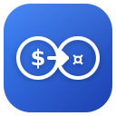

<div align="center">



# Currency Converter Pro

**See every price on the web in your own currency.**

[](LICENSE)
[](https://developer.chrome.com/docs/extensions/develop/migrate/what-is-mv3)
[](manifest.json)

</div>

Currency Converter Pro is a lightweight Chrome extension that finds prices on any web page, such as `$49.99`, `€12,50` or `US $10-11.90`, and converts them to the currency you choose. Hover a price to see the converted amount, or have the extension replace prices in place. It needs no account, has no tracking and no frameworks, and runs on plain JavaScript and Manifest V3.

---

## Features

### Automatic price detection
- Scans pages for prices and watches for new content as you scroll or as single-page apps update.
- Understands many formats:
  - Symbols: `$49.99`, `€12,50`, `£100`, `₪120`, `¥1,000`
  - Prefixed dollars: `US$10`, `C$50`, `A$75`, `NZ$100`, `HK$20`
  - Currency codes: `USD 49.99`, `100 GBP`
  - Symbols after the amount: `12,99 zł`, `100 Kč`, `1 500 Ft`, `45 lei`
  - Ranges: `$10-$20`, `US $10 - 11.90`
  - Abbreviations: `$5k`, `€2.5M`, `£1.2B`
  - Unit prices and qualifiers: `$5 each`, `from $20`, `approximately €100`
  - Cryptocurrencies: `0.001 BTC`, `1.5 ETH`, `100 USDT`
- Handles **fragmented prices** split across several HTML elements, as on Amazon, AliExpress and Newegg.
- Filters out common false positives such as phone numbers.
- Includes tuned selectors for 25+ shopping sites (Amazon, eBay, AliExpress, Walmart, Etsy, Booking.com, Shopify/WooCommerce/Magento stores and more), with generic detection everywhere else.

### Display options
| Mode | What it does | Default |
| --- | --- | --- |
| **Tooltip** | Adds the converted amount to the price's native browser tooltip. Fully compatible with page layouts. | On |
| **Replace prices** | Replaces the price text with the converted amount. The original stays in the tooltip. | Off |
| **Highlight** | Visually marks detected prices. | Off |

You can also set the number of decimal places (or smart rounding), symbol or code display, thousands separators and a minimum price threshold.

### Right-click conversion
- Right-click a detected price and choose **Convert to [your currency]** to convert it in place.
- Or select any price text, right-click, and convert the selection.

### Popup converter
- Quick manual converter with a swap button. It covers about 55 popular fiat currencies and 12 cryptocurrencies.
- Optional sections you can enable in settings:
  - Favorite currencies
  - Refresh, copy, history and rate comparison buttons
  - A stats bar
  - Quick toggles for tooltip, highlight and replace mode

### Exchange rates
- Rates come from **ExchangeRate-API** by default, with no API key needed. You can switch to another provider in the settings (see below).
- Cryptocurrency prices come from **CoinGecko**: BTC, ETH, USDT, USDC, BNB, XRP, ADA, SOL, DOGE, DOT, MATIC, LTC, BCH, LINK, XLM and ATOM.
- Rates are cached locally and refreshed in the background on your chosen interval (1 hour to 2 days, daily by default). Cached rates are used when you are offline or a provider is unavailable.

### Personalization
- 14 themes for the popup and settings page, with Chrome Dark as the default.
- UI scale from 70% to 150%.
- Accessibility options: high contrast, large text and reduced motion.
- Import and export your settings as JSON. When you export, the extension asks before including your API key.
- Debug mode for detailed console logging when troubleshooting.

---

## Installation

### Chrome Web Store
Coming soon.

### Install from source
1. Download this repository as a ZIP and extract it, or clone it:
   ```bash
   git clone https://github.com/KuchiSofts/Currency-Converter-Pro.git
   ```
2. Open `chrome://extensions` in Chrome or any Chromium-based browser.
3. Turn on **Developer mode** (top-right toggle).
4. Click **Load unpacked** and select the `Currency-Converter-Pro` folder (the one that contains `manifest.json`).
5. Pin the extension from the puzzle-piece menu so it is easy to reach.

To update, pull the latest changes (or extract the new ZIP) and click the reload icon on the extension's card in `chrome://extensions`.

## Getting started
1. Click the extension icon and open **Settings** (gear icon).
2. Under **Currency**, choose your **Default Currency**. On first install it is set from your browser's language and region.
3. Browse any shopping site and hover a price to see it in your currency.
4. Optionally turn on **Replace Original Prices** or **Highlight Detected Prices** under **Popup Layout**.

---

## Exchange rate providers

Choose a provider under **Settings > Currency > Exchange Rate API**.

| Provider | API key | Free plan | Coverage | Notes |
| --- | --- | --- | --- | --- |
| [ExchangeRate-API](https://www.exchangerate-api.com) (default) | Not required | Yes, open access | 160+ currencies | Updated daily. Attribution is shown in the popup. |
| [Frankfurter](https://frankfurter.dev) (European Central Bank data) | Not required | Yes | ~30 currencies | Official ECB reference rates, updated on working days. |
| [Bank of Israel](https://www.boi.org.il) | Not required | Yes | ~14 currencies | Official representative rates against ILS. |
| [Open Exchange Rates](https://openexchangerates.org) | Required | Yes, limited requests | 170+ currencies | |
| [CurrencyAPI](https://currencyapi.com) | Required | Yes, limited requests | 150+ currencies | |
| [Fixer.io](https://fixer.io) | Required | Yes, limited requests | 170+ currencies | Free plan uses EUR base. Rebased to USD automatically. |
| [CurrencyLayer](https://currencylayer.com) | Required | Yes, limited requests | 160+ currencies | |

All rates are normalized to a USD base internally. If a provider that needs a key has none, the extension falls back to ExchangeRate-API. If a request fails, the last cached rates are used.

> Rates are for reference only and may differ from the rates your bank or card issuer charges.

---

## How it works

```
 ┌───────────────────┐   getExchangeRates   ┌───────────────────────────┐   HTTPS   ┌──────────────────────┐
 │ content.js        │ ───────────────────▶ │ background.js             │ ────────▶ │ Selected provider    │
 │ (every web page)  │ ◀─────────────────── │ (service worker)          │ ◀──────── │ + CoinGecko (crypto) │
 │ find + convert    │        rates         │ fetch, normalize to USD,  │           └──────────────────────┘
 └───────────────────┘                      │ cache, alarms refresh     │
                                            └─────────────┬─────────────┘
                                                          │ chrome.storage.local
                                                          ▼
                                                 cached rates + timestamp
```

1. **Background service worker** (`background.js`) fetches rates from the selected provider and CoinGecko. It rebases them to USD, stores them in `chrome.storage.local`, and schedules refreshes with `chrome.alarms`.
2. **Content script** (`content.js` plus `lib/`) scans the page using site-specific selectors and generic regex patterns. It identifies each currency from its symbol, code or the site's domain, then converts the price locally.
3. **Results** are shown as native tooltips or as in-place replacements. A `MutationObserver` picks up prices that load later.

## Privacy

Currency Converter Pro collects **no** personal data and has no analytics.

- Settings are stored in `chrome.storage.sync`. Cached rates and popup history are stored in `chrome.storage.local`.
- Network requests go **only** to your selected rate provider and to CoinGecko, and contain no information about you or the pages you visit.
- Page text is read **locally** to find prices and is never sent anywhere.

See [PRIVACY.md](PRIVACY.md) for details.

### Permissions
| Permission | Why |
| --- | --- |
| `storage` | Save settings and cached rates |
| `contextMenus` | Right-click "Convert to ..." menu |
| `alarms` | Background rate refresh on your schedule |
| Host access to rate provider and CoinGecko domains | Fetch exchange rates |
| Content script on all sites | Detect prices on the pages you visit |

---

## Project structure

```
Currency-Converter-Pro/
├── manifest.json          # Extension manifest (MV3)
├── background.js          # Service worker: rate providers, caching, alarms, context menu
├── content.js             # Price detection and conversion engine
├── lib/
│   ├── logger.js          # Debug logging (silent unless debug mode is on)
│   ├── regex.js           # Shared price and currency regex patterns
│   ├── patterns.js        # Currency maps, site selectors, detection rules
│   └── themes.js          # Theme manager
├── pages/
│   ├── popup/             # Toolbar popup (popup.html, popup.js)
│   └── options/           # Settings page (options.html, options.js, tabs.js)
├── styles/                # content.css, popup.css, options.css, themes.css
├── icons/                 # Extension icons (16, 32, 48, 128)
├── PRIVACY.md
└── LICENSE
```

The extension has no build step. The files in the repository are exactly what Chrome loads.

## Contributing

Contributions are welcome.

1. Fork the repository and create a branch: `git checkout -b feature/my-change`.
2. Load the folder as an unpacked extension (see [Install from source](#install-from-source)).
3. Make your changes and reload the extension in `chrome://extensions` to test them. Test on a few real shopping sites, and turn on **Debug Mode** in settings to see detection logs in the console.
4. Check syntax with `node --check <file>.js` for any JavaScript file you changed.
5. Open a pull request that describes the change and the sites you tested.

Please follow the existing code style: plain ES2020+ JavaScript with no frameworks. Report bugs or problem sites in [Issues](https://github.com/KuchiSofts/Currency-Converter-Pro/issues).

### Known limitations
- `$` is ambiguous (USD, CAD, AUD, MXN...). The extension uses prefixes such as `C$` and the site's domain to decide, and otherwise assumes USD.
- Prices drawn on canvas, in images, or inside cross-origin iframes cannot be detected.
- Some heavily scripted sites may re-render prices after they have been replaced.

## Credits and data sources

- **[Rates By Exchange Rate API](https://www.exchangerate-api.com)**: the default exchange rate provider.
- **[Crypto prices powered by CoinGecko](https://www.coingecko.com)**
- Optional providers: [Frankfurter](https://frankfurter.dev) (European Central Bank data), [Bank of Israel](https://www.boi.org.il), [Open Exchange Rates](https://openexchangerates.org), [CurrencyAPI](https://currencyapi.com), [Fixer.io](https://fixer.io) and [CurrencyLayer](https://currencylayer.com).

## License

Released under the [MIT License](LICENSE). © 2026 KuchiSofts.
